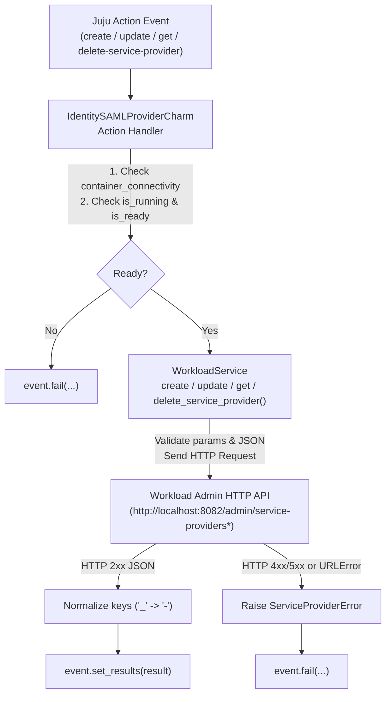

# Design: Add Service Provider Charm Actions

## Context

See `proposal.md` for motivation.

The `identity-saml-provider` workload exposes an internal Admin HTTP API on port
`8082` (`ADMIN_PORT`) that is accessible from the charm container over
`localhost` (`http://localhost:8082`). The Admin API provides two endpoints for
managing SAML Service Providers (SPs):

- `/admin/service-providers`:
  - `POST`: Registers or upserts a Service Provider (`entity_id`, `acs_url`,
    `acs_binding`, and optional `attribute_mapping`).
  - `GET ?entity_id=<entity_id>`: Retrieves an existing Service Provider's
    configuration (`entity_id`, `acs_url`, `acs_binding`, `attribute_mapping`).
- `/admin/service-providers/attribute-mapping`:
  - `PUT ?entity_id=<entity_id>`: Replaces the custom attribute mapping rules
    for an existing Service Provider.
  - `DELETE ?entity_id=<entity_id>`: Clears the custom attribute mapping rules
    for an existing Service Provider, resetting it to default attribute mapping.

In accordance with `AGENTS.DESIGN.md`:

- `src/charm.py` must contain only Juju event handlers and Juju action handlers,
  with no helper methods or data transformation logic.
- `src/services.py` (`WorkloadService`) encapsulates interactions with the
  running workload service.

## Goals / Non-Goals

### Goals

- Expose `create-service-provider`, `update-service-provider`,
  `get-service-provider`, and `delete-service-provider` Juju actions in
  `charmcraft.yaml`.
- Execute Service Provider lifecycle operations against the workload Admin HTTP
  API (`http://localhost:8082/admin/service-providers*`) inside
  `WorkloadService`.
- Support retrieving an existing Service Provider's configuration via `GET
  /admin/service-providers?entity_id=<entity-id>` in `get-service-provider`.
- Support updating attribute mappings exclusively via `PUT` or updating ACS
  fields (`acs-url`, `acs-binding`) alongside optional `attribute-mapping` by
  fetching existing SP state via `GET` and upserting via `POST`.
- Clear custom attribute mappings via `DELETE` in `delete-service-provider`.
- Enforce strict separation between `src/charm.py` orchestration and
  `src/services.py` workload communication.

### Non-Goals

- Exposing the internal Admin API (`8082`) over public ingress (`traefik-route`
  already blocks `/admin`).
- Adding third-party runtime HTTP client dependencies outside the Python
  standard library.

## Decisions

### Decision 1: Use Workload Admin HTTP API via `urllib.request` in `WorkloadService`

- **Rationale**: The workload service already runs an HTTP server on
  `localhost:8082` within the same pod network namespace. Communicating with
  the Admin HTTP API directly from `WorkloadService` using Python's standard
  library `urllib.request`, `urllib.parse`, and `urllib.error` avoids spawning
  Pebble exec subprocesses and avoids introducing `requests` into the charm's
  runtime dependencies (where `requests` is only a test dependency).
- **Alternatives Considered**:
  - *Executing a workload CLI command via `CommandLine` (`src/cli.py`)*: The
    workload manages SP registration and attribute mappings through its Admin
    HTTP API rather than CLI subcommands.

### Decision 2: Composite `update-service-provider` Routing (`PUT` vs `GET` + `POST`)

- **Rationale**: The Admin API provides `PUT
  /admin/service-providers/attribute-mapping?entity_id=...` for replacing
  attribute mappings only, and `POST /admin/service-providers` for upserting the
  full SP record (`entity_id`, `acs_url`, `acs_binding`, `attribute_mapping`).
  - When only `attribute-mapping` is provided to `update-service-provider`,
    `WorkloadService.update_service_provider()` calls `PUT
    /admin/service-providers/attribute-mapping?entity_id=<entity-id>`.
  - When `acs-url` and/or `acs-binding` is provided (with or without
    `attribute-mapping`), `WorkloadService.update_service_provider()` first
    fetches the current SP via `GET /admin/service-providers?entity_id=...`,
    merges the updated fields with existing values, and sends `POST
    /admin/service-providers`.
  - If none of `acs-url`, `acs-binding`, or `attribute-mapping` are provided,
    `ServiceProviderError` is raised immediately.

### Decision 3: `delete-service-provider` Calls `DELETE /admin/service-providers/attribute-mapping`

- **Rationale**: The Admin API exposes `DELETE
  /admin/service-providers/attribute-mapping?entity_id=<entity-id>` as its
  deletion endpoint to clear custom attribute mappings for a service provider
  and reset it to default behavior.

### Decision 4: Normalize Action Result Keys (`_` to `-`) and Serialize Nested `attribute-mapping`

- **Rationale**: Juju action results passed to `ActionEvent.set_results()` must
  use keys containing only lowercase alphanumeric characters, hyphens, and
  periods; underscores (`_`), uppercase characters, or colons at any nested dict
  level raise a `ValueError` in `ops`, and empty nested dicts are dropped. The
  Admin HTTP API returns snake_case keys (e.g., `entity_id`, `acs_url`,
  `acs_binding`, `attribute_mapping`). `WorkloadService._send_admin_request()`
  normalizes top-level response keys by replacing `_` with `-`, and
  `WorkloadService.get_service_provider()` serializes any nested
  `attribute-mapping` dict into a JSON string so arbitrary attribute keys and
  nested structures can be returned safely in Juju action results.

## Risks / Trade-offs

- **[Risk]** Action is invoked when the workload container is disconnected or
  the Pebble service/health checks are not ready.
  → **Mitigation**: Action handlers in `src/charm.py` are decorated with
  `@workload_ready` (defined in `src/utils.py`), which checks
  `container_connectivity(charm)`, `charm._workload_service.is_running`, and
  `charm._workload_service.is_ready` before calling `WorkloadService`, failing
  the action with a clear message if prerequisites are not met.
- **[Risk]** Operator supplies malformed JSON or a non-object JSON value (e.g.,
  list or primitive) for `attribute-mapping`.
  → **Mitigation**: `WorkloadService._parse_attribute_mapping()` validates that
  the string parses as valid JSON and is a `dict`, raising
  `ServiceProviderError` before any HTTP request is made.
- **[Risk]** Admin HTTP API returns an HTTP error (e.g., `400 Bad Request` or
  `404 Not Found`) or connection failure.
  → **Mitigation**: `WorkloadService._send_admin_request()` catches
  `HTTPError`, extracts the structured `"message"` field from the JSON error
  response when available, and raises `ServiceProviderError` so the charm action
  handler calls `event.fail(...)` cleanly.
